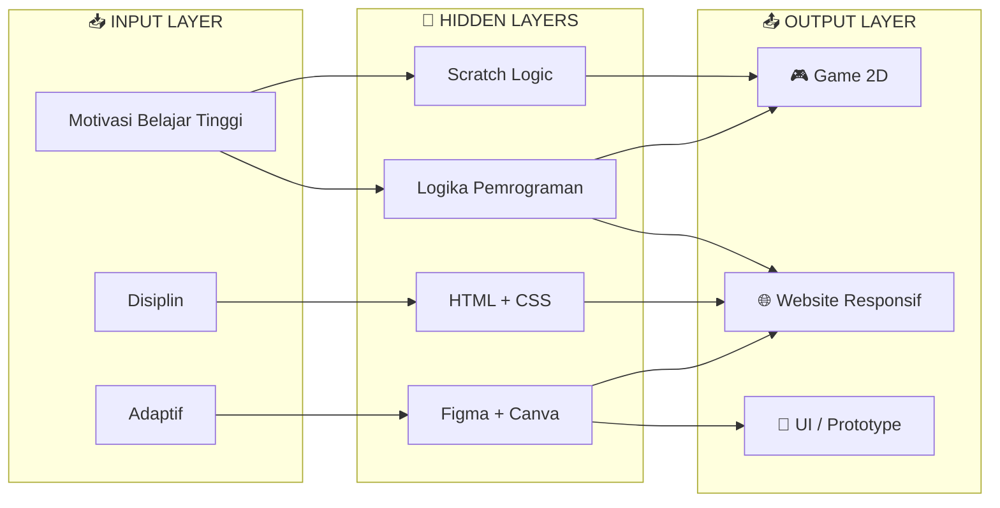

<div align="center">


<a href="https://github.com/MradityaaD">
  
</a>

<br/><br/>


</div>

---

## 🧠 `MODEL_CARD.md`

> *"Siswa aktif SMK TI Dwi Guna jurusan PPLG (Pengembangan Perangkat Lunak dan Gim) yang disiplin, memiliki motivasi belajar tinggi, serta siap mengikuti program PKL untuk menambah pengalaman di dunia kerja."*

| Parameter | Value |
| :-- | :-- |
| 🏷️ **Model Name** | Muhammad Raditya Duta Pratama |
| 🎓 **Architecture** | Siswa PPLG — SMK TI Dwi Guna (Kelas XI PPLG 1) |
| 📍 **Deployed At** | Bogor, Jawa Barat 🇮🇩 |
| 🎯 **Primary Task** | Web Development · UI Design · Game Development |
| ⚙️ **Core Abilities** | Pemrograman dasar · Pengoperasian komputer · Problem solving · Teamwork |
| 🔋 **Learning Rate** | `high` — adaptif, disiplin, kemauan belajar tinggi |
| 🚀 **Next Deployment** | Program PKL (Praktik Kerja Lapangan) |

---

## 🕸️ `NEURAL_ARCHITECTURE`

Alur belajar dan kemampuan saya, digambarkan seperti sebuah neural network:



---

## ⚡ `TRAINING_DATA` — Skill Set

<div align="center">


<br/>


</div>

```text
┌──────────────────────────── TRAINING PROGRESS ────────────────────────────┐
│                                                                           │
│  🌐 Pemrograman Web (HTML/CSS)   ████████████░░░░░░░░  Dasar → Menengah   │
│  🧩 Logika Pemrograman           ███████████░░░░░░░░░  Dasar → Menengah   │
│  🎨 Design & Layouting (Figma)   ████████████░░░░░░░░  Dasar → Menengah   │
│  🎮 Game Logic (Scratch)         ███████████░░░░░░░░░  Dasar → Menengah   │
│  🛠️ VS Code & MS Office          █████████████░░░░░░░  Terbiasa           │
│  🤝 Teamwork & Adaptasi          ██████████████░░░░░░  Kuat               │
│                                                                           │
│  epoch: 2026/2027 ▸ loss ↓ decreasing ▸ skill ↑ increasing                │
└───────────────────────────────────────────────────────────────────────────┘
```

| 🧬 Kemampuan | 📋 Detail |
| :-- | :-- |
| **Pemrograman Web** | Menguasai dasar HTML, CSS, dan logika pemrograman untuk pembuatan website |
| **Design & Layouting** | Mampu merancang alur tampilan (wireframe) dan UI menggunakan Figma & Canva |
| **Tools Pemrograman** | Terbiasa menggunakan VS Code untuk penulisan kode dan MS Office untuk dokumentasi |
| **Soft Skill** | Adaptif, kemauan belajar tinggi, disiplin, dan mampu bekerja sama dalam tim |

---

## 🚀 `DEPLOYED_PROJECTS`

<table>
<tr>
<td width="33%" valign="top">

### 🌐 `web.model`
**Membuat Website Sederhana**

`HTML` `CSS`

- ✅ Tampilan website statis dengan HTML & CSS
- ✅ Tata letak rapi dan **responsif** saat diakses
- ✅ Mempelajari struktur dasar pemrograman web & pengelolaan file proyek

</td>
<td width="33%" valign="top">

### 🎨 `design.model`
**Desain Antarmuka Aplikasi**

`Figma`

- ✅ Alur & tampilan antarmuka (**wireframe / prototype**)
- ✅ Elemen visual: warna, tombol, dan tata letak
- ✅ Sesuai arahan tugas sekolah

</td>
<td width="33%" valign="top">

### 🎮 `game.model`
**Game Flappy Bird 2D**

`Scratch`

- ✅ Game interaktif berbasis logika blok pemrograman
- ✅ Alur lengkap: **start → rintangan → game over**

</td>
</tr>
</table>

---

## 📟 `INFERENCE_LOG` — Riwayat Pendidikan

```log
[2026-2027] INFO   school  = "SMK TI Dwi Guna"
[2026-2027] INFO   major   = "Pengembangan Perangkat Lunak dan Gim (PPLG)"
[2026-2027] INFO   class   = "XI PPLG 1"
[2026-2027] STATUS learning... ████████████████░░░░ 80%
[NEXT]      TASK   PKL → apply knowledge in real-world industry
```

---

## 🎯 `FUTURE_ROADMAP` — Next Training Run

- [x] **v1.0** — Dasar HTML & CSS
- [x] **v1.1** — UI Design dengan Figma & Canva
- [x] **v1.2** — Game 2D dengan Scratch
- [ ] **v2.0** — JavaScript interaktif 🔄
- [ ] **v2.1** — Backend & Database (PHP / MySQL) 🔄
- [ ] **v2.2** — Python & dasar AI / Machine Learning 🔄
- [ ] **v3.0** — 🚀 **PKL di industri software**

---

## 📊 `GITHUB_TELEMETRY`

<div align="center">


</div>

---

## 📡 `API_ENDPOINTS` — Hubungi Saya

<div align="center">

<a href="https://wa.me/6285774464144"></a>
<a href="mailto:pratamaradityaa98@gmail.com"></a>
<br/>
<a href="https://github.com/MradityaaD"></a>
<a href="cv-radit.jpeg"></a>

<br/><br/>

```python
def contact(raditya):
    if ada_ide or tawaran_kolaborasi or lowongan_pkl:
        return "Hubungi saya — siap berkolaborasi! 🤝"
```


<sub>🤖 Trained with curiosity · Optimized by discipline · © 2026 Muhammad Raditya Duta Pratama</sub>

</div>
