Versi teks (aksesibilitas)

**Muhammad Raditya Duta Pratama** — siswa aktif SMK TI Dwi Guna jurusan PPLG (Pengembangan Perangkat Lunak dan Gim) yang disiplin, memiliki motivasi belajar tinggi, serta siap mengikuti program PKL untuk menambah pengalaman di dunia kerja. Memiliki pemahaman dasar pemrograman, pengoperasian komputer, problem solving, dan mampu bekerja sama dalam tim.

- **Pendidikan:** SMK TI Dwi Guna, Pengembangan Perangkat Lunak dan Gim, kelas XI PPLG 1 (2026 - 2027)
- **Focus:** website statis dengan HTML dan CSS, tata letak responsif, desain antarmuka di Figma
- **Learning:** struktur dasar pemrograman web dan pengelolaan file proyek
- **Fun fact:** pernah membuat game Flappy Bird 2D dengan blok Scratch, dari layar start, rintangan, sampai game over
- **Lokasi:** Bogor, Jawa Barat

<table>
  <tr>
    <td width="50%" valign="top" align="center">
      
       
      
      
    </td>
    <td width="50%" valign="top" align="center">
      
       
      
      
    </td>
  </tr>
  <tr>
    <td width="50%" valign="top" align="center">
      
       
      
      
    </td>
    <td width="50%" valign="top" align="center">
      
       
      
      
    </td>
  </tr>
</table>

### 1. General GitHub Stats Card

### 2. Top Languages Card

### 3. GitHub Streak Tracker

### 4. Contribution / Activity Graph

 

