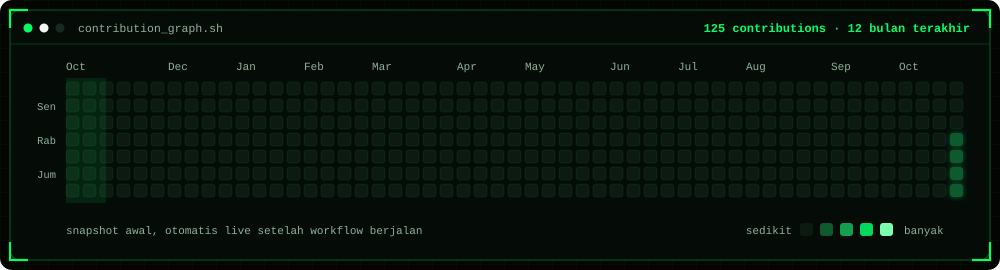

# 🚀 Welcome to My Profile!

---

### 👤 About Me

---

### 🛠️ Tech Stack & Badges

 

---

### 💻 Featured Projects

| Project | Actions |
| :--- | :--- |
|  |   |
|  |   |
|  |   |
|  |   |

---

### 📊 GitHub Stats & Analytics

  
  

---

