


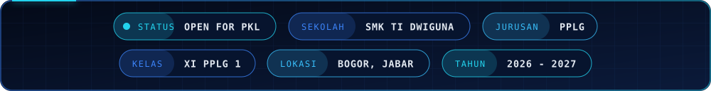

 


 

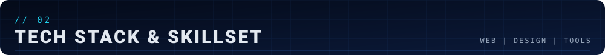
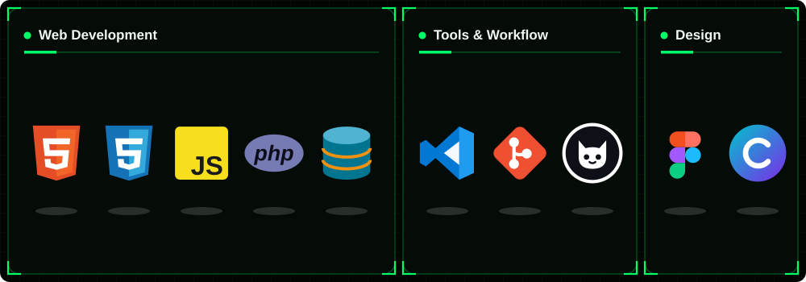

 

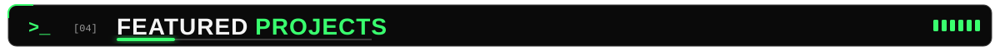

<table>
<tr>
<td width="50%" align="center" valign="top">
<a href="https://takdirkesatria.netlify.app/"></a>
 

</td>
<td width="50%" align="center" valign="top">
<a href="https://mradityaad.github.io/webeduu/"></a>
 

</td>
</tr>
<tr>
<td width="50%" align="center" valign="top">
<a href="https://webwmart.gt.tc/"></a>
 

</td>
<td width="50%" align="center" valign="top">
<a href="https://www.figma.com/proto/R3tSyMyhLPU7x9ufMyvDVl/tugas-uprak?node-id=1-3&p=f&t=tQZ3i0shEoMN2dyk-1&scaling=scale-down&content-scaling=fixed&page-id=0%3A1&starting-point-node-id=1%3A3&show-proto-sidebar=1"></a>
 

</td>
</tr>
</table>

 

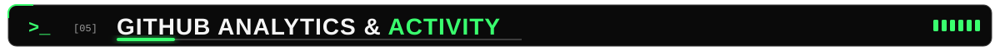

### 1. General GitHub Stats Card

### 2. Top Languages Card

### 3. GitHub Streak Tracker

### 4. Contribution / Activity Graph

 

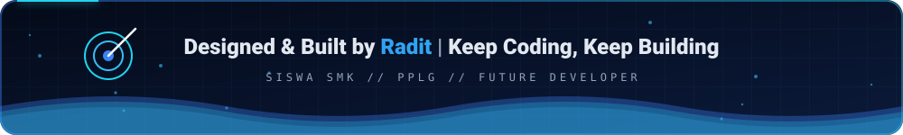

